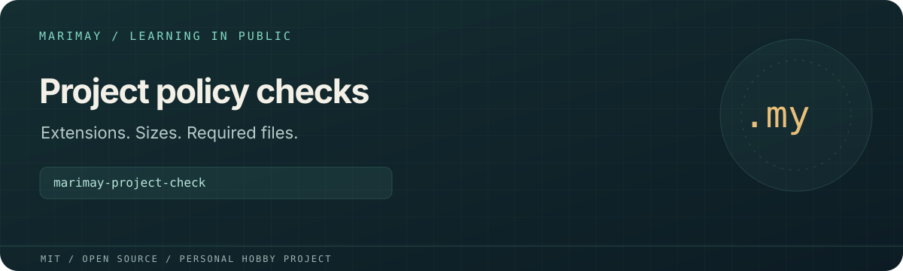

# marimay-project-check



> **Personal learning project.** This open-source MIT project is part of
> [Marimay](https://github.com/marimay-lang/marimay), my hobby programming-language project.
> I maintain it in my spare time to learn by building. APIs and tooling may
> change, and progress may be intermittent.

Checks extensions, maximum file sizes and required regular files using the version 1 or 2 configuration from `marimay-config`.

**Status:** Experimental Marimay learning application. Process acceptance scripts exercise
VM and native Debug/Release execution. Full platform and performance acceptance
remain in progress; existing reports retain their recorded revisions and limits.

## Run and verify

```sh
mmay run . -- --help
mmay run . --allow-read fixtures -- fixtures/config.json --json
mmay fmt . --check
mmay check .
mmay test . --engine both
MMAY="$(command -v mmay)" python3 tools/acceptance.py
mkdir -p build
mmay build . --release --allow-read fixtures --output build/project-check
```

Install a compatible `mmay` and use its matching standard library. Application
arguments follow `--` in `mmay run`. Filesystem and environment access requires
explicit grants; native grants are selected at build time.

Pinned configuration and traversal packages are included for independent builds;
`PROVENANCE.json` records their origin. `project.root` is relative to the working
directory. Reports include accessible entries and traversal errors; incomplete
scans use `unverified` where absence cannot be established. Symlinks are not
followed. Entry, depth and JSON-size limits are explicit.

Python generates synthetic inputs and drives independent process checks;
application logic is written in Marimay. `MMAY=/absolute/path/to/mmay` selects
the compiler for Python drivers. `python3 tools/measure.py` runs the existing
measurement harness and writes local reports under `build/`.

See [`BUDGETS.md`](BUDGETS.md), [`ERGONOMICS.md`](ERGONOMICS.md), [`VERIFICATION.md`](VERIFICATION.md) for project-specific budgets,
findings and historical verification details.

## License

[MIT](LICENSE). Existing copyright attribution is retained.
